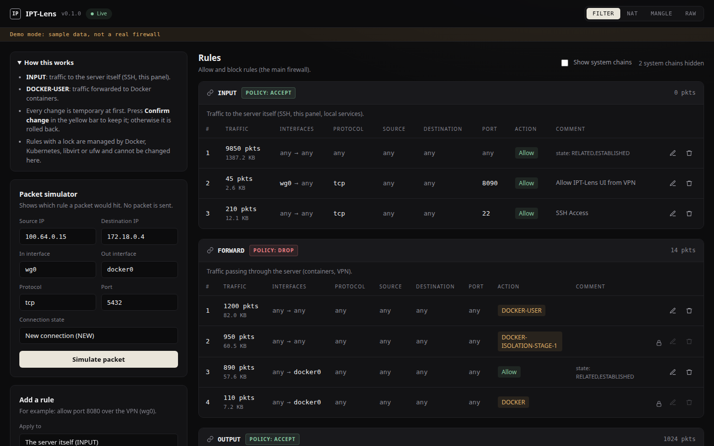

# IPT-Lens

[](https://github.com/quvonchbek-devops/ipt-lens/actions/workflows/ci.yml)
[](LICENSE)

A small web panel for reading and safely changing **iptables** on a Linux server.
One static Go binary, no dependencies, no database.



## Why

`iptables -L` is hard to read on a host that runs Docker, and one wrong rule over
SSH can lock you out. IPT-Lens shows the ruleset as it really is, chain by chain,
explains where a packet will go, and makes every change **temporary until you
confirm it**. If you lose access and cannot confirm, the change rolls itself back.

## Features

- **Readable ruleset.** All four tables, chains in kernel order, packet and byte
  counters, interface and Docker container names next to addresses.
- **Packet simulator.** Enter source, destination, interfaces, protocol and port;
  see every chain and rule the packet passes through, including DNAT rewrites and
  jumps into user-defined chains. Results that depend on matches the simulator
  cannot evaluate (ipset, limit, ...) are marked approximate.
- **Safe changes.** Add, edit or delete a rule. Each change is applied together
  with its undo, and is rolled back automatically unless you confirm it in time.
  The pending change is written to disk first, so even a crash or restart
  rolls it back.
- **Protected chains.** Rules managed by Docker, Kubernetes, Calico, libvirt or
  ufw are shown with a lock and cannot be changed.
- **Strict input.** New rules are checked against an allowlist of options and
  targets and passed to `iptables` as arguments. No shell is ever involved.
- **Stale-view protection.** Edits and deletes carry the rule you saw; if the
  ruleset changed in the meantime, the request is refused instead of hitting
  the wrong rule.

## Quick start (demo, no root)

```sh
git clone https://github.com/quvonchbek-devops/ipt-lens
cd ipt-lens
make demo            # http://127.0.0.1:8090, sample data, the firewall is never touched
```

Requires Go 1.21 or newer.

## Install on a server

Download a release archive from the
[releases page](https://github.com/quvonchbek-devops/ipt-lens/releases), or build it:

```sh
make build
sudo install -m 0755 ipt-lens /usr/local/bin/ipt-lens
```

Run it with systemd:

```sh
sudo install -D -m 0644 deploy/ipt-lens.service /etc/systemd/system/ipt-lens.service
sudo install -D -m 0600 deploy/ipt-lens.env.example /etc/ipt-lens/env
sudoedit /etc/ipt-lens/env          # set IPTLENS_TOKEN and IPTLENS_ARGS
sudo systemctl daemon-reload
sudo systemctl enable --now ipt-lens
```

### Where to expose it

IPT-Lens controls your firewall. **Do not expose it to the internet.** Good options:

- Keep the default `127.0.0.1:8090` and reach it through an SSH tunnel:
  `ssh -L 8090:127.0.0.1:8090 you@server`.
- Bind it to a VPN address such as WireGuard (`--listen 10.8.0.1:8090`) and allow
  that port only on the VPN interface.

A token (`IPTLENS_TOKEN`, at least 16 characters) is required whenever the listen
address is not loopback. Generate one with `openssl rand -hex 24`. The UI asks for
it once and keeps it for the browser session only.

### Keeping changes after a reboot

iptables rules live in the kernel and are lost on reboot. Pass
`--persist-file /etc/iptables/rules.v4` and IPT-Lens saves the full ruleset there
each time you confirm a change. Pair it with a loader such as
`iptables-persistent` (Debian/Ubuntu) or `iptables-services` (RHEL family). Without
the flag, the UI tells you that a confirmed change lasts only until reboot.

## Configuration

| Flag | Default | Meaning |
|---|---|---|
| `--listen` | `127.0.0.1:8090` | Address to listen on |
| `--demo` | `false` | Serve built-in sample data; never touch the firewall |
| `--rollback-timeout` | `60s` | Time to confirm a change before it is rolled back |
| `--state-dir` | `/var/lib/ipt-lens` | Backups and the pending change |
| `--keep-backups` | `20` | Number of `iptables-save` snapshots to keep |
| `--persist-file` | (empty) | Save the ruleset here on confirm |
| `--allowed-hosts` | (empty) | Extra host names accepted in the `Host` header, for reverse proxies |
| `--version` | | Print the version and exit |

| Environment | Meaning |
|---|---|
| `IPTLENS_TOKEN` | Bearer token for the API. Required on non-loopback addresses |

## How a change works

1. Your request is validated and the target rule is checked against what you saw.
2. A full `iptables-save` snapshot is written to `--state-dir` (the newest 20 are kept).
3. The change and its undo are written to `pending.json`.
4. The change is applied. If a step fails, the steps already applied are undone.
5. A timer starts. **Confirm** keeps the change, and saves it to `--persist-file`
   if one is set. If the timer runs out, the undo runs.
6. On start, a leftover `pending.json` means the last change was never confirmed,
   so it is rolled back.

Only one change can be pending at a time.

## HTTP API

All endpoints are under `/api/v1`, take and return JSON, and need
`Authorization: Bearer <token>` when a token is set. POST requests must use
`Content-Type: application/json`. Cross-site requests are refused.

| Method | Path | Body | Purpose |
|---|---|---|---|
| GET | `/state` | | Ruleset, version, pending status |
| POST | `/simulate` | `src_ip, dst_ip, proto, dst_port, in_iface, out_iface, ct_state` | Trace a packet |
| POST | `/apply` | `table, chain, position, rule` | Add a rule (`position` 0 appends) |
| POST | `/rules/edit` | `table, chain, rule_id, expect, rule` | Replace a rule |
| POST | `/rules/delete` | `table, chain, rule_id, expect` | Delete a rule |
| POST | `/confirm` | | Keep the pending change |

`GET /healthz` returns `ok` without authentication.

## Limitations

- IPv4 only (`iptables`, not `ip6tables`).
- The simulator covers `nat/PREROUTING`, `filter/INPUT`, `filter/FORWARD` and
  `nat/POSTROUTING`. Locally generated traffic (`OUTPUT`) and the `mangle` and
  `raw` tables are shown but not simulated.
- New rules accept a limited set of options and the targets `ACCEPT`, `DROP`,
  `REJECT` and `RETURN`.
- Undoing a delete re-inserts the rule at its old position. If another tool
  changed the chain in the meantime, the position may be off.

See [docs/ROADMAP.md](docs/ROADMAP.md) for what is planned.

## Contributing

Bug reports, ideas and pull requests are welcome. Read
[CONTRIBUTING.md](CONTRIBUTING.md) first. Please report security problems
privately, as described in [SECURITY.md](SECURITY.md).

## License

[MIT](LICENSE) © 2026 Quvonchbek Nuriddinov
